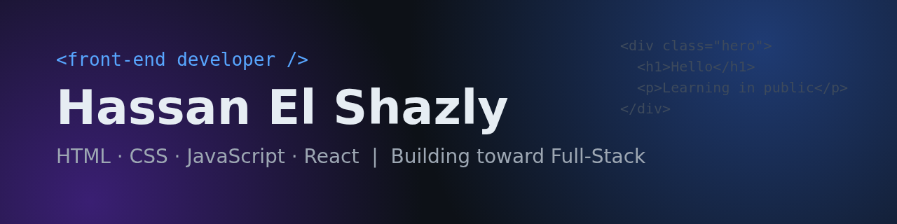

  

## Hi, I'm Hassan 👋

I'm a Computer Science student at Modern Academy in Cairo, Egypt. I build front-end pages and small apps with HTML, CSS, JavaScript and React, and I also work in C++. Building toward full-stack.

## What I work with

## Projects

- **[Portfolio](https://hassan-el-shazly.github.io)** - my personal site: dark and light themes, CSS animations, responsive down to phone width. [code](https://github.com/Hassan-El-Shazly/Hassan-El-Shazly.github.io)
- **[Portfolio app](https://hassan-el-shazly.github.io/portfolio-app/)** - the same portfolio as an installable app that opens offline (web app manifest + service worker). [code](https://github.com/Hassan-El-Shazly/portfolio-app)
- **[Study Planner (React)](https://hassan-el-shazly.github.io/study-planner-react/)** - the same planner rebuilt in React with Vite and hooks: components, one state object, `useMemo` for the plan. [code](https://github.com/Hassan-El-Shazly/study-planner-react)
- **[Study Planner](https://hassan-el-shazly.github.io/study-planner/)** - spreads your study hours across the days before your exams, in English or Arabic. [code](https://github.com/Hassan-El-Shazly/study-planner)
- **[Restaurant landing page](https://hassan-el-shazly.github.io/restaurant-landing/)** - responsive page with CSS animations, a printed-menu layout and a booking form. [code](https://github.com/Hassan-El-Shazly/restaurant-landing)
- **[Product landing page](https://hassan-el-shazly.github.io/product-landing/)** - a fictional soda brand with a CSS-only can and a flavor switcher. [code](https://github.com/Hassan-El-Shazly/product-landing)

Right now: JavaScript and React, one small project at a time.

## Find me

